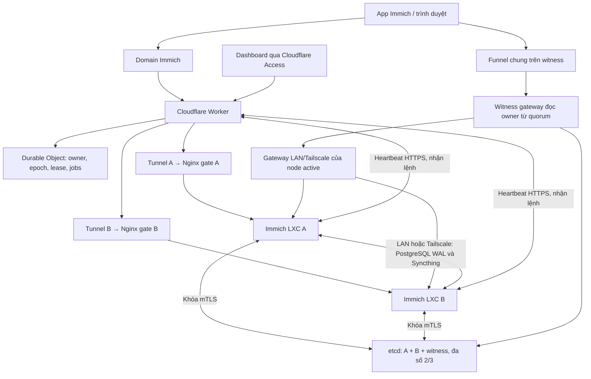

# Immich HA

Hệ thống dự phòng cho **hai Immich native chạy trong Proxmox LXC**: PostgreSQL streaming truyền database, Syncthing truyền ảnh/video, Cloudflare Worker điều phối chính và cung cấp dashboard. Có thể thêm witness/quorum để agent tiếp tục điều phối khi mất Cloudflare, rồi tùy chọn bật gateway/Funnel làm đường truy cập dự phòng.

Chỉ **một máy active được ghi dữ liệu**. Witness đặt trên máy vật lý thứ ba, không chứa thư viện ảnh hoặc replica PostgreSQL. Đọc [cách hoạt động](cloudflare-ha/ARCHITECTURE.vi.md) để hiểu failover, đồng bộ ngược, tự trở về máy ưu tiên và xử lý sự cố Cloudflare.

## Kiến trúc

Sơ đồ đầy đủ khi đã bật witness/Funnel; cài hai node cơ bản không yêu cầu các thành phần tùy chọn này.



| Thành phần | Chức năng |
| --- | --- |
| Worker | Giao diện, xác thực quản trị, chuyển tiếp request tới active |
| Durable Object | Nguồn quyết định owner/epoch/lease, tuần tự hóa bàn giao |
| Agent Python | Nhận grant/lệnh qua heartbeat, kiểm tra và điều khiển dịch vụ cục bộ |
| Nginx gate | Chỉ mở truy cập khi token, epoch, lease và mode hợp lệ |
| PostgreSQL `16/ha`, cổng `5433` | Streaming bất đồng bộ; standby chỉ đọc, promote khi được cấp quyền |
| Syncthing | Truyền file ảnh/video, danh mục WAL và backup SQL theo chiều active → standby |
| LAN / Tailscale | Kết nối dữ liệu trực tiếp trong LAN, hoặc tailnet tùy chọn khi cần |
| etcd trên hai node và witness | Khóa chung/lease native; không lưu ảnh hoặc database Immich |
| Witness gateway và Funnel chung | Một URL dự phòng theo active; chỉ định tuyến, không cấp quyền ghi |
| Dịch vụ điều khiển Funnel trên witness | Nhận yêu cầu bật/tắt listener chung, báo xác nhận về dashboard |

Witness/quorum giữ khóa chung và cho phép fallback khi mất kết nối Cloudflare; Cloudflare vẫn điều phối chính khi hoạt động. Gateway witness đọc owner từ quorum rồi proxy tới node có grant, không cấp quyền ghi. Funnel chung xuất bản gateway thành một URL HTTPS tự đi theo active. Hai Funnel riêng từng node là tùy chọn bổ sung.

Cài mới theo [WITNESS-SETUP.vi.md](cloudflare-ha/WITNESS-SETUP.vi.md). [QUORUM.vi.md](cloudflare-ha/QUORUM.vi.md) giữ chi tiết giao thức và runbook cũ, không phải chuỗi lệnh cần chạy lại sau init/join.

`primary` và `backup` là **ID cố định**, không phải vai trò cố định. Cả hai máy đều có thể làm active. Lần cài đầu khởi tạo owner là `primary`; sau đó vai trò theo trạng thái đã lưu.

## Đã có

- Dashboard Mushroom: vai trò, CPU/RAM, dung lượng, số ảnh/video, Syncthing, Tailscale, backup và lịch sử.
- Tự tiếp quản khi sự cố được xác nhận; tự đưa máy quay lại về dự phòng; chọn máy ưu tiên và tự trở về.
- Bàn giao bằng **WAL + danh mục file**, không tạo/nạp dump trong luồng streaming.
- Bàn giao nhanh khi có đủ bằng chứng nguồn đã dừng/khóa bền vững và đích đủ WAL/file. Thiếu điều kiện thì không bỏ fencing.
- Bảo trì từng máy và thông báo Slack cấu hình trên UI.
- Đồng bộ các backup `.sql.gz`/`.sql` gốc Immich sang máy còn lại.
- Dashboard nâng cấp Immich theo recipe đã rà soát: staging riêng, backup cuối, xác nhận cả hai máy và khóa bàn giao khi có lỗi. Xem [quy trình nâng cấp ứng dụng](cloudflare-ha/IMMICH-UPGRADE.vi.md).
- Giám sát Funnel chung qua Internet; ⚙ xem URL/IP, mở/sao chép; công tắc bật/tắt có xác nhận từ witness.

## Triển khai

### Cài mới trực tiếp, không SSH

Sau khi lấy cùng source/commit trên hai LXC:

```bash
# Trên LXC A
bash install.sh init

# Trên LXC B
bash install.sh join
```

A hỏi cấu hình Cloudflare và cấp mã join; B nhập mã rồi tự cài cục bộ. Chọn **LAN** nếu cùng mạng, **Tailscale** nếu cần; không có máy quản trị riêng hoặc SSH giữa hai node. Theo dõi cài đặt trên dashboard. Xem [INSTALL.vi.md](cloudflare-ha/INSTALL.vi.md).

Luồng installer mới được kiểm thử mô phỏng, **chưa nghiệm thu end-to-end trên hai LXC cài mới**. Không chạy init/join trên HA đang hoạt động.

### Chọn phạm vi triển khai

| Phạm vi | Thành phần | Khi Cloudflare không truy cập được |
| --- | --- | --- |
| Hai node cơ bản | Worker/dashboard + hai agent + PostgreSQL streaming + Syncthing | Không có bộ điều phối thay thế; gate đóng khi grant hết hạn |
| Mở rộng dự phòng Cloudflare | Thêm quorum A/B/witness, fallback và gateway/Funnel | Agent có thể tiếp tục điều phối theo khóa quorum; dùng đường truy cập dự phòng đã cài |

Bản live hiện dùng cả hai lớp. `init/join` chỉ cài **hai node cơ bản**. Muốn mở rộng, chủ động dùng `witness-init`/`witness-join`, rồi tùy chọn `funnel-enable`; xem [hướng dẫn witness/Funnel không SSH](cloudflare-ha/WITNESS-SETUP.vi.md). Không tự cài witness mặc định. Các bộ cài mới chưa nghiệm thu end-to-end trên LXC mới.

Bắt đầu tại [DEPLOYMENT.vi.md](cloudflare-ha/DEPLOYMENT.vi.md). Các bước SSH cũ được giữ trong [runbook thủ công](cloudflare-ha/MANUAL-DEPLOYMENT.vi.md) để bảo trì; không phải yêu cầu của bộ cài mới. Không chạy `init/join` lên bản live.

| Tài liệu | Nội dung |
| --- | --- |
| [INSTALL.vi.md](cloudflare-ha/INSTALL.vi.md) | Init/join cục bộ, không SSH; LAN/Tailscale tùy chọn |
| [ARCHITECTURE.vi.md](cloudflare-ha/ARCHITECTURE.vi.md) | Quyền ghi, đường truy cập, failover/failback và các tình huống lỗi |
| [DEPLOYMENT.vi.md](cloudflare-ha/DEPLOYMENT.vi.md) | Điểm bắt đầu: chọn phạm vi, điều kiện và thứ tự triển khai |
| [CLOUDFLARE-SETUP.vi.md](cloudflare-ha/CLOUDFLARE-SETUP.vi.md) | Lấy Account/Zone ID, tạo API token, chuẩn bị domain và đăng nhập dashboard |
| [WITNESS-SETUP.vi.md](cloudflare-ha/WITNESS-SETUP.vi.md) | Witness tùy chọn qua HTTPS, LAN/Tailscale, gateway và Funnel không SSH |
| [CONFIG.vi.md](cloudflare-ha/CONFIG.vi.md) | Domain/IP, SSH jump host, thông tin riêng và đổi cấu hình |
| [STREAMING.vi.md](cloudflare-ha/STREAMING.vi.md) | Stage, cutover, WAL, fencing và bàn giao nhanh |
| [DASHBOARD.vi.md](cloudflare-ha/DASHBOARD.vi.md) | Vận hành, backup, bảo trì, kiểm tra và log |
| [QUORUM.vi.md](cloudflare-ha/QUORUM.vi.md) | Quorum mTLS, grant bắt buộc, fallback, gateway và Funnel |
| [AGENTS.md](AGENTS.md) | Quy ước làm việc với source dành cho coding agent |
| [GITHUB.vi.md](GITHUB.vi.md) | Kiểm tra source và đóng gói trước khi chia sẻ |

## Kiểm thử và preview

Python 3.12+, Node.js 24. Test mặc định không cần token hoặc kết nối production:

```bash
cd cloudflare-ha
python -m unittest discover -s tests -p "test_*.py"
node --test tests/*.test.mjs
python tools/embed-ui.py
python tools/prepare-github.py
node preview-server.mjs
```

Preview tại `http://127.0.0.1:8788` dùng dữ liệu mô phỏng. GitHub Actions chỉ kiểm tra source, không tự deploy hay SSH vào LXC.

## Giới hạn cần hiểu

- **Không phải zero downtime.** Vẫn có thời gian chốt file/WAL, promote và khởi động Immich. Read-only browsing/PgBouncer mới là nghiên cứu, chưa triển khai.
- Streaming và Syncthing là hai luồng bất đồng bộ. Sự cố có thể xảy ra khi metadata/file chưa đến đủ; không cam kết RPO bằng không.
- Streaming không thay backup. Backup SQL chỉ chứa database; khôi phục cần ảnh/video tương ứng. SQL backup được đồng bộ không có nghĩa đã được thử restore.
- Bộ cài streaming hiện dành cho PostgreSQL **16**, cluster `ha`, cổng `5433`, database `immich_stream`, native layout `/opt/immich`; không phải bộ cài chung cho Docker/mọi phiên bản PostgreSQL.
- Code legacy dump vẫn phục vụ bootstrap/migration và tương thích cũ. Luồng streaming mới không dùng dump để bàn giao; lịch dump định kỳ có thể tắt bằng chính sách cục bộ.
- Quorum cần đa số 2/3. Mất witness làm mất gateway/Funnel chung, nhưng không nhất thiết làm mất đa số hoặc hai Funnel riêng. Mất Cloudflare có thể làm mất domain chính và dashboard; đường dự phòng phải được cài và thử trước.
- Archive PostgreSQL vật lý và danh mục WAL chưa có cơ chế tự dọn chung. Theo dõi dung lượng, không xóa khi đang có job.

## Bảo vệ cấu hình riêng

Không commit `.env`, `project.json`, `wrangler.jsonc`, `generated/`, mật khẩu, private key, webhook, database backup hoặc ZIP node. **`generated/` chứa khóa và định danh deployment: phải giữ riêng để cập nhật đúng hệ thống**, không xóa rồi sinh lại.

```bash
cd cloudflare-ha
python tools/prepare-github.py
python tools/prepare-github.py --zip
```

ZIP chia sẻ: `generated/github-source.zip`. Nó khác `primary-v2.zip` / `backup-v2.zip`, vốn chứa token riêng.

Xem [nguồn tài sản bên thứ ba](THIRD_PARTY_NOTICES.md). Chủ dự án chưa chọn LICENSE cho toàn repo.
