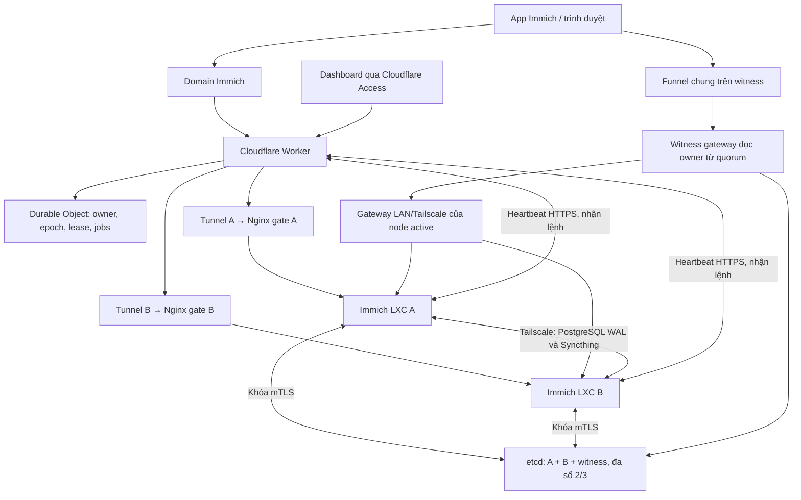

# Immich HA

Hệ thống dự phòng cho **hai Immich native chạy trong Proxmox LXC**: PostgreSQL streaming truyền database, Syncthing truyền ảnh/video, Cloudflare Worker điều phối chính và cung cấp dashboard. Quorum etcd ba thành viên giữ khóa chung để agent tiếp tục điều phối khi mất Cloudflare. Gateway và Tailscale Funnel cung cấp đường truy cập dự phòng.

Chỉ **một máy active được ghi dữ liệu**. Witness đặt trên máy vật lý thứ ba, không chứa thư viện ảnh hoặc replica PostgreSQL. Đọc [cách hoạt động](cloudflare-ha/ARCHITECTURE.vi.md) để hiểu failover, đồng bộ ngược, tự trở về máy ưu tiên và xử lý sự cố Cloudflare.

## Kiến trúc



| Thành phần | Chức năng |
| --- | --- |
| Worker | Giao diện, xác thực quản trị, chuyển tiếp request tới active |
| Durable Object | Nguồn quyết định owner/epoch/lease, tuần tự hóa bàn giao |
| Agent Python | Nhận grant/lệnh qua heartbeat, kiểm tra và điều khiển dịch vụ cục bộ |
| Nginx gate | Chỉ mở truy cập khi token, epoch, lease và mode hợp lệ |
| PostgreSQL `16/ha`, cổng `5433` | Streaming bất đồng bộ; standby chỉ đọc, promote khi được cấp quyền |
| Syncthing | Truyền file ảnh/video, danh mục WAL và backup SQL theo chiều active → standby |
| Tailscale | Kết nối riêng giữa hai LXC, kể cả khi khác mạng |
| etcd trên hai node và witness | Khóa chung/lease native; không lưu ảnh hoặc database Immich |
| Witness gateway và Funnel chung | Một URL dự phòng theo active; chỉ định tuyến, không cấp quyền ghi |
| Dịch vụ điều khiển Funnel trên witness | Nhận yêu cầu bật/tắt listener chung, báo xác nhận về dashboard |

Lớp quorum ba thành viên triển khai theo checkpoint: [QUORUM.vi.md](cloudflare-ha/QUORUM.vi.md). Bước 3b bắt buộc xác nhận khóa chung; bước 3c bổ sung điều phối dự phòng khi mất kết nối Cloudflare và đối chiếu quyền khi Cloudflare hồi phục. Cloudflare vẫn điều phối chính. Gateway LAN/Tailscale (4a) và HTTPS Funnel từng node (4b) là đường vào có grant gate riêng; bật 3c chưa tự tạo đường truy cập thay thế domain Cloudflare.

Gateway witness (4c) cung cấp đường vào chung, đọc owner từ quorum rồi proxy tới gateway node. Nó chỉ định tuyến, không cấp quyền ghi. Funnel chung trên witness (4d) bổ sung một URL HTTPS tự đi theo active; hai Funnel node vẫn giữ làm đường truy cập trực tiếp khi cần.

`primary` và `backup` là **ID cố định**, không phải vai trò cố định. Cả hai máy đều có thể làm active. Lần cài đầu khởi tạo owner là `primary`; sau đó vai trò theo trạng thái đã lưu.

## Đã có

- Dashboard Mushroom: vai trò, CPU/RAM, dung lượng, số ảnh/video, Syncthing, Tailscale, backup và lịch sử.
- Tự tiếp quản khi sự cố được xác nhận; tự đưa máy quay lại về dự phòng; chọn máy ưu tiên và tự trở về.
- Bàn giao bằng **WAL + danh mục file**, không tạo/nạp dump trong luồng streaming.
- Bàn giao nhanh khi có đủ bằng chứng nguồn đã dừng/khóa bền vững và đích đủ WAL/file. Thiếu điều kiện thì không bỏ fencing.
- Bảo trì từng máy và thông báo Slack cấu hình trên UI.
- Đồng bộ các backup `.sql.gz`/`.sql` gốc Immich sang máy còn lại.
- Dashboard nâng cấp Immich theo recipe đã rà soát: staging riêng, backup cuối, xác nhận cả hai máy và khóa bàn giao khi có lỗi. Xem [quy trình nâng cấp ứng dụng](cloudflare-ha/IMMICH-UPGRADE.vi.md).
- Giám sát Funnel chung qua Internet; ⚙ xem URL/IP, mở/sao chép; công tắc bật/tắt có xác nhận từ witness.

## Triển khai

**Bắt đầu tại [hướng dẫn triển khai từ đầu](cloudflare-ha/DEPLOYMENT.vi.md)**. Tài liệu phân biệt lệnh chạy trên máy quản trị, Proxmox host và bên trong LXC.

Thứ tự tổng quát:

1. Chuẩn bị hai LXC Immich cùng phiên bản, PostgreSQL 16 và media mount cùng đường dẫn.
2. Cài Tailscale **bên trong hai LXC**; cấu hình Syncthing và hoàn tất đồng bộ file.
3. Điền `project.json` / `.env`, triển khai Worker và tạo hai Tunnel tới Nginx gate.
4. Cài agent quan sát, runtime v2 và enforcement; xác nhận dự phòng trước khi nâng cấp streaming.
5. Stage/test/cutover PostgreSQL streaming; bật đồng bộ SQL backup, tắt lịch dump định kỳ nếu chọn mô hình hiện tại.
6. Kiểm tra mount, version, source/standby, backup và quyền phục vụ; cuối cùng mới bật tự động.
7. Chuẩn bị witness trên máy vật lý thứ ba; cài quorum isolated → shadow → grant bắt buộc → fallback.
8. Gateway node → Funnel riêng → gateway witness → Funnel chung; thử app ở từng checkpoint, rồi cài giám sát/điều khiển Funnel.

Không chạy lại bước cài mới trên hệ thống đang hoạt động. Dùng mục **Cập nhật** trong hướng dẫn. Installer không tự chuẩn bị ổ đĩa, cài Immich hay tạo DNS/Access/Tunnel.

### Cấu hình máy quản trị

Từ thư mục repo:

```bash
cd cloudflare-ha
cp project.example.json project.json
cp .env.example .env
python -m venv .venv
```

Kích hoạt venv theo hệ điều hành, rồi:

```bash
python -m pip install -r requirements-ssh.txt
```

PowerShell dùng `Copy-Item` thay `cp` nếu cần. Điền domain, IP, email, Cloudflare Access Team domain/AUD trong `project.json`; khóa Cloudflare và SSH trong `.env`. Thay giá trị mẫu bằng giá trị thật, không sửa cứng vào code.

| Tài liệu | Nội dung |
| --- | --- |
| [ARCHITECTURE.vi.md](cloudflare-ha/ARCHITECTURE.vi.md) | Quyền ghi, đường truy cập, failover/failback và các tình huống lỗi |
| [DEPLOYMENT.vi.md](cloudflare-ha/DEPLOYMENT.vi.md) | Cài HA, Tailscale, Syncthing, Worker, Tunnel, Access và agent |
| [CONFIG.vi.md](cloudflare-ha/CONFIG.vi.md) | Domain/IP, SSH jump host, thông tin riêng và đổi cấu hình |
| [STREAMING.vi.md](cloudflare-ha/STREAMING.vi.md) | Stage, cutover, WAL, fencing và bàn giao nhanh |
| [DASHBOARD.vi.md](cloudflare-ha/DASHBOARD.vi.md) | Vận hành, backup, bảo trì, kiểm tra và log |
| [QUORUM.vi.md](cloudflare-ha/QUORUM.vi.md) | Quorum mTLS, grant bắt buộc, fallback, gateway và Funnel |
| [AGENTS.md](AGENTS.md) | Quy ước làm việc với source dành cho coding agent |
| [GITHUB.vi.md](GITHUB.vi.md) | Kiểm tra source và đóng gói trước khi chia sẻ |

## Kiểm thử và preview

Python 3.12+, Node.js 24. Test mặc định không cần token hoặc kết nối production:

```bash
cd cloudflare-ha
python -m unittest discover -s tests -p "test_*.py"
node --test tests/*.test.mjs
python tools/embed-ui.py
python tools/prepare-github.py
node preview-server.mjs
```

Preview tại `http://127.0.0.1:8788` dùng dữ liệu mô phỏng. GitHub Actions chỉ kiểm tra source, không tự deploy hay SSH vào LXC.

## Giới hạn cần hiểu

- **Không phải zero downtime.** Vẫn có thời gian chốt file/WAL, promote và khởi động Immich. Read-only browsing/PgBouncer mới là nghiên cứu, chưa triển khai.
- Streaming và Syncthing là hai luồng bất đồng bộ. Sự cố có thể xảy ra khi metadata/file chưa đến đủ; không cam kết RPO bằng không.
- Streaming không thay backup. Backup SQL chỉ chứa database; khôi phục cần ảnh/video tương ứng. SQL backup được đồng bộ không có nghĩa đã được thử restore.
- Bộ cài streaming hiện dành cho PostgreSQL **16**, cluster `ha`, cổng `5433`, database `immich_stream`, native layout `/opt/immich`; không phải bộ cài chung cho Docker/mọi phiên bản PostgreSQL.
- Code legacy dump vẫn phục vụ bootstrap/migration và tương thích cũ. Luồng streaming mới không dùng dump để bàn giao; lịch dump định kỳ có thể tắt bằng chính sách cục bộ.
- Quorum cần đa số 2/3. Mất witness làm mất gateway/Funnel chung, nhưng không nhất thiết làm mất đa số hoặc hai Funnel riêng. Mất Cloudflare có thể làm mất domain chính và dashboard; đường dự phòng phải được cài và thử trước.
- Archive PostgreSQL vật lý và danh mục WAL chưa có cơ chế tự dọn chung. Theo dõi dung lượng, không xóa khi đang có job.

## Bảo vệ cấu hình riêng

Không commit `.env`, `project.json`, `wrangler.jsonc`, `generated/`, mật khẩu, private key, webhook, database backup hoặc ZIP node. **`generated/` chứa khóa và định danh deployment: phải giữ riêng để cập nhật đúng hệ thống**, không xóa rồi sinh lại.

```bash
cd cloudflare-ha
python tools/prepare-github.py
python tools/prepare-github.py --zip
```

ZIP chia sẻ: `generated/github-source.zip`. Nó khác `primary-v2.zip` / `backup-v2.zip`, vốn chứa token riêng.

Xem [nguồn tài sản bên thứ ba](THIRD_PARTY_NOTICES.md). Chủ dự án chưa chọn LICENSE cho toàn repo.
