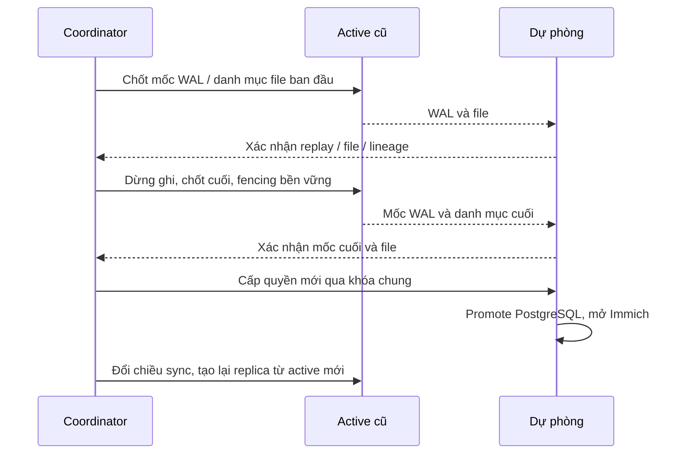

# Cách Immich HA hoạt động

Cài mới chia hai phạm vi: `init/join` tạo HA hai node với Cloudflare; `witness-init`/`witness-join` bổ sung quorum/fallback/gateway nếu người vận hành chọn. Mỗi máy nhận tác vụ cố định qua HTTPS và tự cài cục bộ, không dùng SSH. Quorum/gateway dùng LAN hoặc Tailscale theo mạng của A/B; Funnel là bước tùy chọn riêng, cần Tailscale trên máy xuất bản URL. [WITNESS-SETUP.vi.md](WITNESS-SETUP.vi.md) là luồng mới chưa nghiệm thu E2E; bản live cũ giữ nguyên các định danh và cách triển khai.

## Ba lớp độc lập

| Lớp | Thành phần | Quyết định |
| --- | --- | --- |
| Dữ liệu | PostgreSQL streaming và Syncthing trên hai LXC | Truyền database và file; không cấp quyền active |
| Điều phối | Cloudflare Durable Object, agent và quorum etcd ba thành viên | Máy được ghi, epoch/session, thời hạn grant và thứ tự bàn giao |
| Truy cập | Worker/Tunnel/gate, gateway LAN/Tailscale, witness gateway và Funnel | Định tuyến tới máy có quyền; đăng nhập vẫn do Immich |

`primary` và `backup` là ID cài đặt, không phải vai trò cố định. `owner` là node đang được cấp quyền active; `epoch` tăng khi quyền thay đổi. Session và thời hạn lease ngăn tiến trình/heartbeat cũ dùng quyền đã hết hạn. Witness không phải replica PostgreSQL; quorum này khác QDevice của cluster Proxmox.

## Bình thường

1. Hai agent gửi heartbeat và nhận lệnh/grant từ Worker. Durable Object lưu owner, epoch, lease, jobs và cài đặt tự động.
2. Sau khi bật enforcement quorum, agent phải xác nhận khóa chung qua etcd mTLS trước khi promote, khởi động app hoặc mở origin. etcd giữ generation bền vững và active key có TTL native.
3. Chỉ active chạy Immich đầy đủ worker và PostgreSQL writable. Standby PostgreSQL ở recovery, Immich dừng; agent theo dõi mount, WAL và file để báo sẵn sàng.
4. PostgreSQL truyền WAL qua LAN hoặc Tailscale đã cấu hình. Syncthing truyền media theo chiều active Send Only → standby Receive Only. Folder `immich-database` truyền manifest bàn giao và dữ liệu legacy còn giữ, **không phải PGDATA đang chạy**.
5. Domain chính đến Worker → Tunnel → origin gate của active. Gate yêu cầu đúng token, epoch, grant còn hạn và mode hợp lệ. App cổng 2283 chỉ nghe loopback.

Số ảnh/video trên dashboard đọc từ database từng máy và làm mới khoảng một phút. “Đã đồng bộ” của Syncthing không xác nhận trạng thái WAL; “Đang nhận WAL” cũng không xác nhận mọi file đã tới.

## Chuyển active có kế hoạch

Luồng streaming dùng WAL + manifest, không dump/restore để bàn giao. Nguồn phải dừng app/ML, đóng origin, dừng PostgreSQL và lưu mode frozen bền vững. Chỉ đủ bằng chứng nguồn đã fenced và đích nhận đúng WAL/file mới được bỏ khoảng đệm của bàn giao nhanh. Không có bằng chứng thì vẫn chờ fencing, không dùng một khoảng sleep ngắn thay xác nhận.

Sau khi đích phục vụ, máy cũ được chuẩn bị lại bằng base backup từ active mới khi cần, giữ PGDATA cũ trong archive riêng. Vì vậy “Mở phục vụ” có thể đã xong trong khi đồng bộ ngược vẫn chạy. Chỉ kết luận dự phòng sẵn sàng khi kiểm tra cuối thành công.

## Sự cố và máy cũ trở lại

Coordinator không promote chỉ vì một ping lỗi. Nó cần xác nhận nguồn lỗi, chờ quyền cũ không còn dùng được và kiểm tra replica đủ điều kiện. Các mặc định gồm lease Cloudflare 240 giây, khoảng đệm fencing 30 giây và xác nhận lỗi 300 giây; các mốc có thể chồng lấn, không phải cam kết thời gian phục hồi cố định.

Máy trở lại không tự mở ghi từ database cũ. Nó nhận quyền/mode hiện tại, đóng writer cũ, đồng bộ từ owner mới và kiểm tra lại. **Tự đồng bộ dự phòng** cho phép coordinator chuẩn bị lại standby. **Tự trở về máy ưu tiên** cho phép bắt đầu một job bàn giao đầy đủ sau khoảng 2 phút đủ điều kiện ổn định. Tự trở về không đồng nghĩa tự chuyển khi sự cố.

Tự chuyển khi sự cố được giữ bật trong vận hành bình thường. UI không có công tắc tắt tính năng này; API vận hành vẫn cần cho bootstrap và script bảo trì/rollout. Khóa job, nâng cấp và maintenance vẫn có hiệu lực.

## Khi Cloudflare gián đoạn

Fallback phải đã được bật, quorum còn đa số và grant/policy hợp lệ:

- Writer hiện tại có thể chuyển authority sang fallback trên cùng khóa quorum, cùng owner/epoch, sau grace của lỗi điều phối.
- Chuyển sang node khác cần hết native lease, xác nhận nguồn vắng, policy cho phép và kiểm tra seed/WAL/media. Không chọn node chỉ vì ping được.
- Fallback không tự rebuild replica hoặc chạy các job nâng cấp/bàn giao Cloudflare cũ.
- Khi Cloudflare hồi phục, nonce/CAS đối chiếu quyền với writer thực tế. Trạng thái Cloudflare cũ không được ép quay về một epoch hay database cũ.

Mất đa số không cấp quyền mới; grant cục bộ có hạn và origin đóng khi hết quyền. Điều kiện chi tiết xem [QUORUM.vi.md](QUORUM.vi.md).

## Các đường truy cập

| Đường | Đích | Khi đổi active |
| --- | --- | --- |
| Domain chính | Worker → Tunnel → origin gate | Worker chọn owner hợp lệ |
| Gateway từng node | Nginx cục bộ → app loopback | Chỉ node active mở được |
| Funnel riêng từng node | Gateway của node đó | URL không tự đổi node; standby đóng |
| Gateway LAN/Tailscale witness | Đọc owner quorum → gateway node | Tự theo owner có lease hợp lệ |
| Funnel chung | Gateway witness | Giữ một URL qua các lần chuyển active |

Witness router chỉ đọc quorum tuyến tính, cache ngắn và đóng khi không xác nhận route; không cấp grant. Proxy không tự replay POST sang node khác khi upstream lỗi. Origin gate vẫn kiểm tra quyền cục bộ ngay cả khi route vừa được cache.

Witness là phụ thuộc của đường chung. Nếu witness lỗi, có thể dùng Funnel riêng của active hoặc gateway node qua Tailscale/LAN. Các đường này vẫn yêu cầu đăng nhập Immich. Không mở agent, etcd, PostgreSQL hay Syncthing GUI ra Funnel. Funnel còn phụ thuộc Tailscale và Internet, không phải một hạ tầng hoàn toàn độc lập.

## Giám sát và công tắc Funnel

Worker kiểm tra URL chung mỗi phút bằng ping có nonce riêng và yêu cầu không dùng cache. Chỉ phản hồi Immich hợp lệ, có header node/epoch khớp owner, mới báo hoạt động. Kết quả quá 3 phút được đánh dấu cũ. Độ trễ là thời gian HTTP, không phải ping Tailscale.

Công tắc lưu yêu cầu trong storage riêng của Durable Object. Timer `immich-ha-funnel-control` trên witness lấy yêu cầu mỗi khoảng 15 giây, đổi đúng listener chung đã quản lý rồi báo lại revision/trạng thái. UI chờ xác nhận; không đổi owner, PostgreSQL hoặc Funnel riêng. Token chuyên dụng không có quyền điều phối Immich. Mất Cloudflare thì dịch vụ giữ Funnel hiện có; dashboard/monitor có thể không truy cập được trong lúc đó.

## Những gì cần sao lưu

| Dữ liệu | Ý nghĩa |
| --- | --- |
| Ảnh/video và backup media độc lập | Nội dung gốc; file bị xóa có thể được Syncthing truyền xóa theo |
| SQL backup gốc `.sql.gz` / `.sql` | Database theo thời điểm; cần media tương ứng |
| PGDATA archive / base backup | Bản sao vật lý riêng, không đồng bộ qua Syncthing |
| Manifest WAL | Mốc WAL và danh mục file kiểm chứng bàn giao; không chứa database |
| Dump legacy | Bootstrap/migration cũ; không dùng để bàn giao streaming |
| `project.json`, `.env`, `generated/`, cấu hình witness và khóa | Định danh, token, CA và thông tin cần để cập nhật/khôi phục deployment; lưu riêng an toàn |

Replication không thay backup lịch sử. Restore phải được thử riêng; test controller không chứng minh khôi phục đầy đủ database và media.
